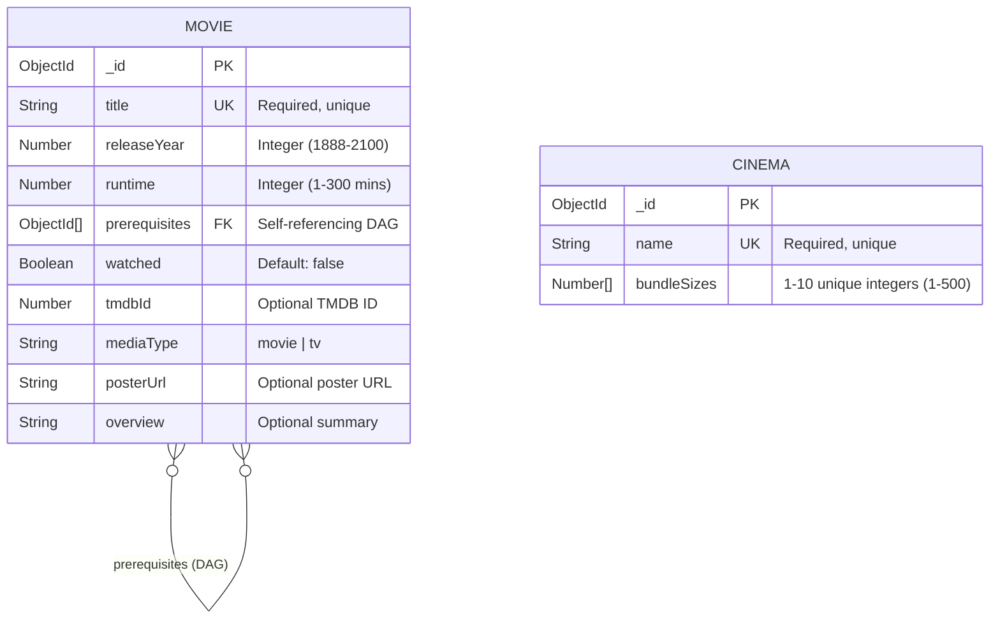

# Doomsday Ready

A full-stack MCU rewatch planner and opening-night watch-party booking app built with **React + Tailwind CSS**, **Express**, and **MongoDB**.

---

## Features

1. **Movies & Rewatch Order**
   - Create and manage movies (`title`, `releaseYear`, `runtime` 1–300 min, `prerequisites`, `watched`).
   - Prevents direct and transitive circular dependencies with **`409 CIRCULAR_DEPENDENCY`**.
   - Computes a topological rewatch order (excluding the target movie), watched count, progress bar, and remaining unwatched runtime.
   - Optional server-side **TMDB integration** (`TMDB_ACCESS_TOKEN`) for search-to-autofill and metadata enrichment during database seeding.
2. **Cinemas & Watch-Party Booking**
   - Create cinemas offering 1–10 unique seat bundle sizes (each 1–500 seats).
   - Computes the exact minimum number of seat bundles for a group size (1–10,000) with zero empty seats using Dynamic Programming, or reports **"Not possible"**.
3. **4-Page Frontend**
   - **Home** (`/`), **Movies** (`/movies`), **Rewatch Plan** (`/rewatch-plan`), and **Booking** (`/booking`).

---

## Data Model Diagram



---

## Project Structure

```text
DoomTracker/
├── server/
│   ├── .env.example
│   ├── src/
│   │   ├── algorithms/       # Pure library-free JS logic (Feature 1 & Feature 2)
│   │   ├── config/           # MongoDB connection
│   │   ├── controllers/      # Route handlers
│   │   ├── middleware/       # Error formatting
│   │   ├── models/           # Mongoose schemas
│   │   ├── routes/           # Express routes
│   │   ├── seed/             # Curated MCU dataset + TMDB-enriched seeder
│   │   ├── services/         # TMDB API wrapper
│   │   ├── app.js
│   │   └── index.js
│   └── tests/                # Node built-in unit tests (node:test)
└── client/
    └── src/
        ├── api/              # Fetch API wrapper
        ├── components/       # Layout & MovieForm
        └── pages/            # HomePage, MoviesPage, RewatchPlanPage, BookingPage
```

---

## Setup & Running Locally

### 1. Environment Variables
Create `server/.env` based on `server/.env.example`:

```env
PORT=5000
MONGO_URI=your_mongodb_connection_string
TMDB_ACCESS_TOKEN=optional_tmdb_v4_read_access_token
```

### 2. Install Dependencies

```bash
cd server && npm install
cd ../client && npm install
```

### 3. Seed Sample MCU Movies & Cinemas (Optional)

```bash
cd server
npm run seed
# Or pass --reset to wipe and re-seed:
npm run seed -- --reset
```

If `TMDB_ACCESS_TOKEN` is configured, the seeder enriches movies with TMDB metadata and posters; otherwise it falls back cleanly to local values.

### 4. Run Backend & Frontend

```bash
# Terminal 1 (Server on http://localhost:5000)
cd server
npm run dev

# Terminal 2 (Client on http://localhost:5173, proxies /api -> localhost:5000)
cd client
npm run dev
```

### 5. Run Algorithm Unit Tests

```bash
cd server
npm test
```

---

## API Reference (`/api`)

| Method & Path | Purpose |
|---|---|
| `POST /api/movies` | Create a movie |
| `GET /api/movies` | List all movies (sorted by release year, title) |
| `PATCH /api/movies/:id` | Update a movie (`watched`, `prerequisites`, or details); rejects cycles with `409 CIRCULAR_DEPENDENCY` |
| `DELETE /api/movies/:id` | Delete a movie and remove it from other movies' prerequisites |
| `GET /api/movies/:id/rewatch-order` | Compute topological rewatch list, watched count, and remaining watch time |
| `POST /api/cinemas` | Create a cinema with 1–10 unique bundle sizes (1–500) |
| `GET /api/cinemas` | List all cinemas |
| `DELETE /api/cinemas/:id` | Delete a cinema |
| `GET /api/cinemas/:id/booking?groupSize=6` | Calculate optimal seat bundle breakdown or `"Not possible"` |
| `GET /api/tmdb/search?q=...` | Search TMDB titles (optional autofill helper) |
| `GET /api/tmdb/details/:type/:tmdbId` | Fetch TMDB details & runtime (optional autofill helper) |

---

## Assumptions & Design Choices

- **Chronological tie-breaking:** When multiple prerequisite movies are ready to watch at the same step in topological order, they are sorted by `releaseYear` ascending (then `title` ascending) so the rewatch list follows natural MCU release order.
- **No external algorithm libraries:** Both Feature 1 (iterative DFS cycle detection + Kahn's topological sort) and Feature 2 (bottom-up Dynamic Programming with backtracking) are implemented from scratch in `server/src/algorithms/`.
- **Impossible booking quotes:** `GET /api/cinemas/:id/booking` returns HTTP `200` with `{ possible: false, totalBundles: 0, bundles: [], message: "Not possible" }` when no exact bundle sum exists, while invalid inputs return `400`.
- **Database name fallback:** When `MONGO_URI` omits a database path (e.g., ends with `/`), the server connects using the `doomsday_ready` database by default.
- **TMDB optionality:** `TMDB_ACCESS_TOKEN` stays strictly on the server. Core app features work without TMDB, and TMDB search returns `503 TMDB_NOT_CONFIGURED` if no token is provided.

---

## AI Tools Usage

AI assistance (Antigravity) was used to scaffold the full-stack folder layout, draft boilerplate Express/React/Tailwind components, generate unit test suites covering the assessment scenarios, and draft documentation (`README.md`). All core algorithms for Feature 1 and Feature 2, validation rules, and edge-case tests were reviewed and verified locally.
